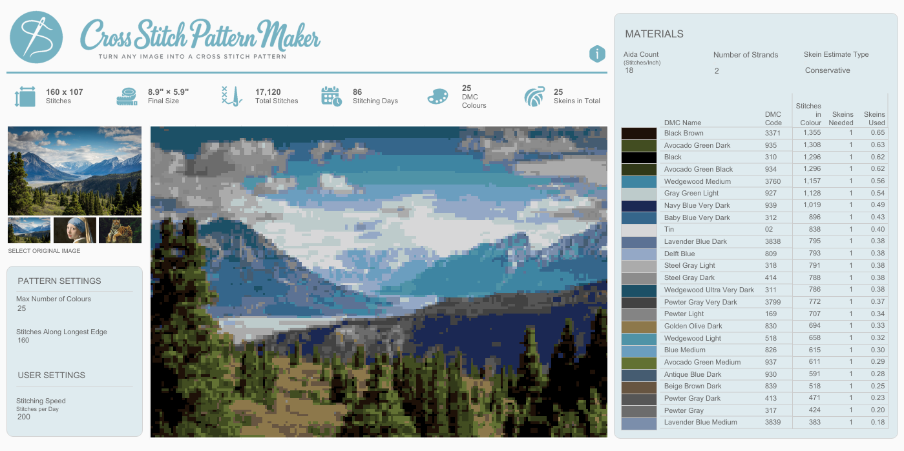
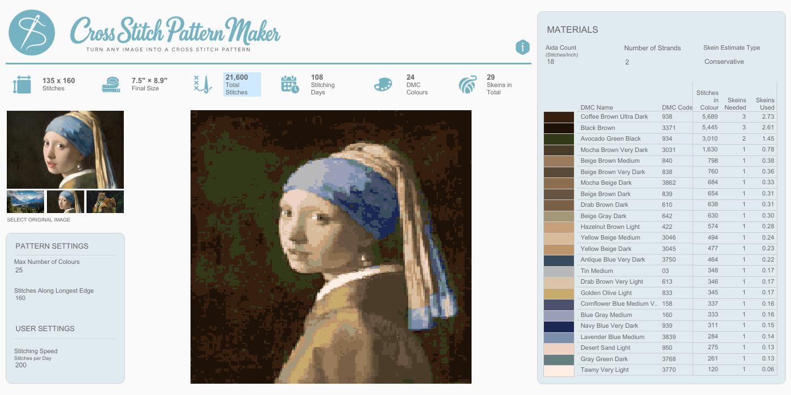
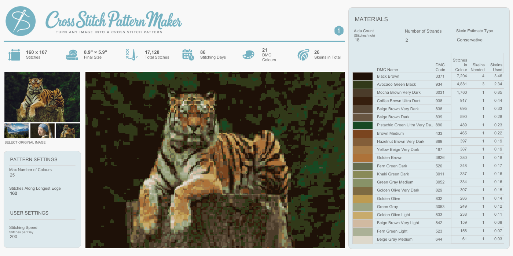
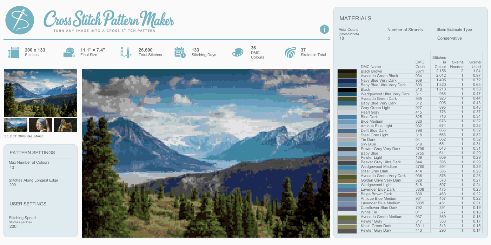
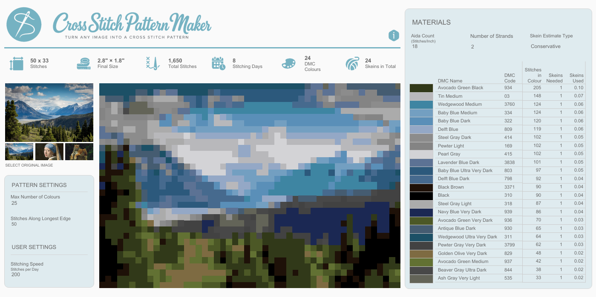
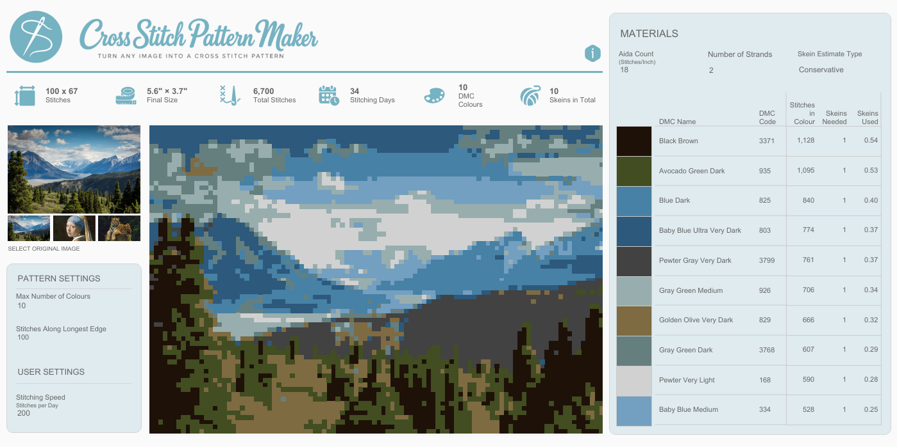

# Cross-Stitch Pattern Maker 🧵

An interactive cross-stitch pattern generator built with **Python, Tableau and TabPy**.

The project converts an image into a cross-stitch pattern using DMC embroidery thread colours. Users can experiment with the number of stitches, the maximum number of thread colours, and Aida fabric count to preview the finished design and estimate the materials required.

The original **Tableau Desktop + TabPy** version generates patterns dynamically. A separate, precomputed version was developed for **Tableau Public**, where published dashboards cannot run live TabPy calculations.

**[Explore the interactive dashboard on Tableau Public](https://public.tableau.com/app/profile/holly.andersen/viz/CrossStitchPatternBuilder/TableauPublicVersionLandscape)**

The published dashboard is ready to explore in a browser. The downloadable Tableau workbook also includes the Desktop/TabPy implementation, which can be configured to use a different source image.

## Dashboard examples

Three example patterns generated using the Tableau dashboard. The second row shows how changing the stitch count and maximum thread colours affects the same source image. Click any screenshot to see it full-size.

<table width="100%">
  <tr>
    <td align="center" width="33%">
      <a href="images/final_dashboard_images/Topexample1.png"></a>
      <br><sub>Mountain landscape</sub>
    </td>
    <td align="center" width="33%">
      <a href="images/final_dashboard_images/Topexample2.png"></a>
      <br><sub>Girl with a Pearl Earring</sub>
    </td>
    <td align="center" width="33%">
      <a href="images/final_dashboard_images/Topexample3.png"></a>
      <br><sub>Tiger</sub>
    </td>
  </tr>
  <tr>
    <td align="center">
      <a href="images/final_dashboard_images/Bottomexample1.png"></a>
      <br><sub><strong>200 stitches</strong> · 40 colours</sub>
    </td>
    <td align="center">
      <a href="images/final_dashboard_images/Bottomexample2.png"></a>
      <br><sub><strong>50 stitches</strong> · 25 colours</sub>
    </td>
    <td align="center">
      <a href="images/final_dashboard_images/Bottomexample3.png"></a>
      <br><sub><strong>100 stitches</strong> · 10 colours</sub>
    </td>
  </tr>
</table>

## Features

- **Custom image input:** Generate a pattern from your own image using the preprocessing script.
- **Adjustable pattern resolution:** Choose the number of stitches along the image's longest edge, preserving its aspect ratio.
- **Adjustable colour palette:** Set a maximum number of DMC thread colours to balance detail against the number of colours to purchase.
- **DMC colour matching:** Match image colours to real DMC embroidery threads.
- **Fabric selection:** Choose an Aida fabric count to estimate the finished dimensions.
- **Materials estimates:** View required threads and approximate skein quantities, with standard and conservative estimates.
- **Interactive preview:** See how changing the pattern settings affects the design.

## How it works

The Desktop workflow combines Python preprocessing with dynamic calculations in Tableau and TabPy.

### 1. Image preprocessing — Python

An image is resized to a maximum of **60,000 pixels** while preserving its aspect ratio. The script creates one row per resized image pixel, recording its X/Y coordinates, RGB values and image dimensions.

It also appends a **DMC colour scaffold**: one extra row for every thread in the lookup palette, containing its identifier, colour name and reference RGB values.

### 2. Stitch generation — Tableau

The user chooses a stitch count along the image's longest edge. Tableau groups pixels into stitch areas and calculates their average RGB values, so the stitch resolution can be changed without preprocessing the image again.

### 3. Colour reduction and matching — TabPy

Tableau sends the stitch colours to Python through TabPy. K-means clustering reduces the number of colours, and the resulting colours are matched to the nearest DMC threads using Euclidean RGB distance.

### 4. Pattern display and material estimates — Tableau

TabPy returns DMC thread labels to Tableau, which renders the pattern using a custom DMC colour palette. Tableau also calculates stitch counts, physical dimensions and estimated thread requirements.

### Why use a DMC scaffold?

Tableau assigns custom palette colours to discrete values according to their ordering. Without the scaffold, a different subset of DMC threads could cause colours to be assigned inconsistently when pattern settings change.

Including every DMC thread in a consistent order keeps the palette mapping stable. Scaffold rows are excluded from stitch counts and materials calculations. **The current TabPy calculations still read the DMC lookup CSV separately**; the scaffold is used to support correct colour assignment in Tableau.

## Running the Desktop + TabPy version

### Requirements

- Python 3
- Tableau Desktop
- A running [TabPy](https://github.com/tableau/TabPy) server
- Python packages: `numpy`, `pandas`, `Pillow` and `scikit-learn`
- The DMC lookup CSV (`dmc_threads.csv`)
- The Tableau workbook and its custom DMC colour palette

### 1. Clone the repository

```bash
git clone https://github.com/hollyxandersen/Cross-Stitch-Pattern-Maker.git
cd Cross-Stitch-Pattern-Maker
```

### 2. Install dependencies

```bash
pip install -r requirements.txt
```

The Python environment running **TabPy** must also have `numpy`, `pandas` and `scikit-learn` installed. Installing packages into a different Python environment will not make them available to TabPy.

### 3. Generate the image dataset

Place your image in `images/` and ensure the DMC lookup is in `data/`. Configure the preprocessing script to use those paths and to write the output CSV to your preferred location.

For a script stored in `desktop-tabpy/generate_image_data.py`, the following settings point to folders at the **repository root**:

```python
from pathlib import Path

REPO_ROOT = Path(__file__).resolve().parent.parent
IMAGE_PATH = REPO_ROOT / "images" / "example_image.jpg"
DMC_LOOKUP_PATH = REPO_ROOT / "data" / "dmc_threads.csv"
OUTPUT_PATH = REPO_ROOT / "data" / "image_pixels_with_dmc_scaffold.csv"
MAX_PIXELS = 60_000
```

Replace `example_image.jpg` with your image's filename and adjust these paths if your folders are arranged differently.

Run from the repository root:

```bash
python desktop-tabpy/generate_image_data.py
```

This generates `image_pixels_with_dmc_scaffold.csv`, containing one row per resized image pixel and one DMC scaffold row per reference thread. The CSV includes the pixel coordinates, RGB values, image dimensions and DMC metadata required by the Desktop workbook.

### 4. Configure TabPy and update the DMC lookup path

Start TabPy and connect Tableau Desktop to it through **Help → Settings and Performance → Manage Analytics Extension Connection** (menu wording may differ by Tableau version).

The downloaded workbook includes **six TabPy calculated fields** that currently refer to the original development machine's DMC lookup CSV. To run the Desktop implementation on another machine, change the path in each calculation.

**Find this exact path:**

```text
C:/Users/HollyAndersen/Downloads/dmc_threads (1).csv
```

**Replace it with the absolute path to your own lookup file**, for example:

```text
C:/Users/YourName/Documents/Cross-Stitch-Pattern-Maker/data/dmc_threads.csv
```

Each affected calculation contains a `pd.read_csv(...)` call similar to:

```python
dmc = pd.read_csv(
    'C:/Users/HollyAndersen/Downloads/dmc_threads (1).csv'
)
```

Edit the quoted path inside the calculation to match where you have stored `dmc_threads.csv`. You do **not** need to change the clustering or matching logic.

Update the path in these six Tableau calculated fields:

| Calculated field | Role |
| --- | --- |
| `Matched Thread (Size Fix)` | Pixel-based pattern preview |
| `Matched DMC Thread` | Stitch-based colour matching |
| `Matched DMC Thread 2` | Additional thread-colour view |
| `DMC Name` | Thread colour names |
| `DMC Code` | Thread identifiers |
| `Stitches per Thread – TabPy` | Thread usage and materials estimates |

These are the **six distinct calculated fields** containing the old path in the downloadable workbook. Edit them within Tableau Desktop, then ensure the DMC file is accessible to the Python process running TabPy.

### 5. Open the Tableau workbook and connect your data

Download the workbook from **[Tableau Public](https://public.tableau.com/app/profile/holly.andersen/viz/CrossStitchPatternBuilder/TableauPublicVersionLandscape)** and open it in Tableau Desktop.

The workbook includes both the published, precomputed implementation and the original Desktop implementation with its embedded TabPy calculations.

To generate patterns from your own image:

1. Run the preprocessing script (Step 3) to create a new `image_pixels_with_dmc_scaffold.csv`.
2. In Tableau Desktop, locate the original Desktop data source, **`image_pixels_with_dmc_scaffold`**.
3. Change or replace its connection to use your new CSV. If Tableau is using a packaged `.hyper` extract, update the underlying connection and refresh or recreate the extract as necessary.
4. Make sure TabPy is connected and all six DMC lookup paths are updated (Step 4).
5. Ensure the **custom DMC palette** is installed and correctly assigned in Tableau.
6. Open the Desktop pattern dashboard and adjust the stitch count, maximum colours, Aida count and thread estimates.

Once configured, changes to pattern settings are calculated dynamically by Tableau and TabPy. The preprocessing script only needs to be rerun when you change the **source image**.

> **Note:** The published Tableau Public dashboard uses precomputed data and does not execute live TabPy calculations. The dynamic Desktop version must be opened and configured locally in Tableau Desktop.

## Tableau Public version

A separate preprocessing script is included in `tableau_public/` to support a shareable dashboard without live TabPy integration.

### Why a separate implementation?

The Desktop version computes stitch grouping and colour matching dynamically. A published Tableau Public dashboard cannot execute those live TabPy calculations, so the Public version performs the computationally intensive work in Python **before** loading the results into Tableau.

### What the Public script does

The script is designed for **Google Colab**. It requests **three source images** and a DMC palette CSV or Excel file.

For each image, it generates patterns using four predefined stitch counts along the longest edge (**50, 100, 160 and 200**) and four maximum-colour settings (**10, 25, 40 and 60**).

For every image and stitch setting, the script:

1. Resizes the source image to the chosen stitch dimensions.
2. Fits K-means clusters for each maximum-colour option.
3. Matches the resulting cluster colours to DMC thread colours.
4. Expands the stitch pattern onto a consistent display grid with a **200-pixel longest edge**, so individual stitches remain visible as blocks.
5. Generates stitch coordinates, identifiers and weights for accurate counting.
6. Adds DMC scaffold rows for each image and stitch-setting combination.
7. Validates the output and packages the generated files for download.

The Public workbook can then switch between these precomputed variations using Tableau parameters without calling TabPy.

### Running the Public preprocessing script

Open the script in `tableau_public/` in Google Colab and run it. When prompted, upload exactly three images followed by a compatible DMC lookup CSV or Excel file. The script installs missing Python packages and downloads a ZIP of the outputs:

| Output file | Contents |
| --- | --- |
| `tableau_public_cross_stitch_pixels.csv` | Precomputed image and thread assignments |
| `dmc_palette_clean.csv` | Standardised DMC lookup |
| `cross_stitch_generation_summary.csv` | Settings, stitch counts and colour summaries |
| `tableau_public_cross_stitch_data.zip` | ZIP containing the three CSVs |

Unlike the dynamic Desktop implementation, the published version is limited to the stitch and colour combinations that have been precomputed.

---

*Built as a personal project exploring image processing, clustering, Python integration and interactive data visualisation — with the practical goal of making cross-stitch patterns easier to design and plan.*
